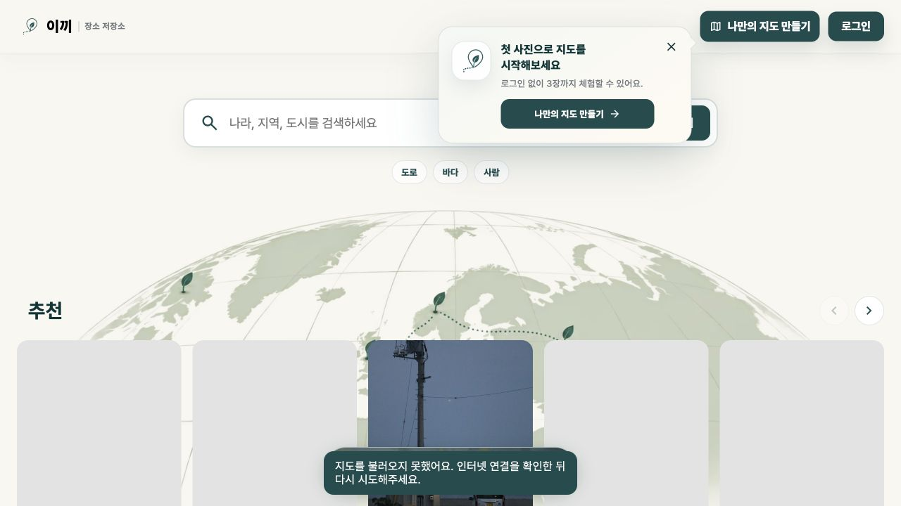
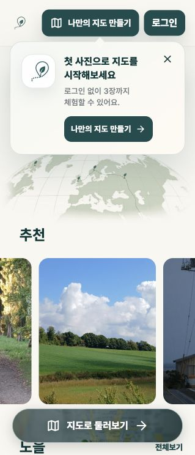
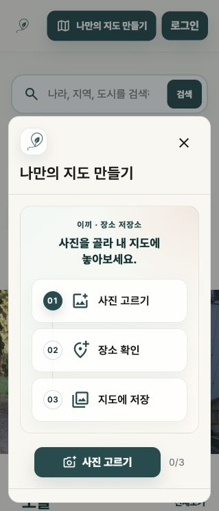
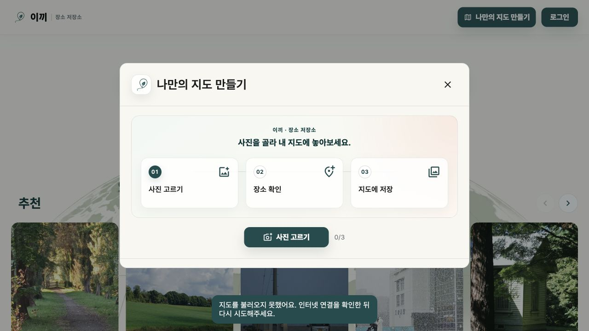
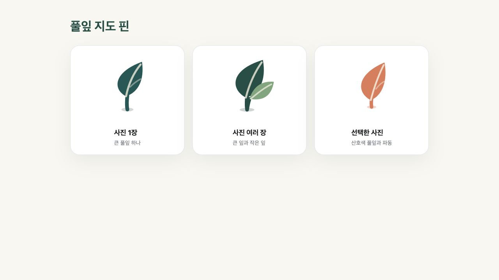

# 나만의 지도 만들기 온보딩 디자인 검수

검수일: 2026-10-29  
범위: 비회원 안내 카드, 사진 등록 3단계 첫 화면, 375px·초소형 모바일 헤더, 풀잎 지도 핀

## 전체 판정

데스크톱과 모바일 모두 핵심 행동이 분명하고, `이끼 · 장소 저장소`의 따뜻한 아이보리·청록 계열과 자연스럽게 이어진다. 안내 카드를 누른 뒤 카드가 모달 뒤에 남던 문제, 375px 전후에서 브랜드와 지도 만들기 버튼이 겹치던 문제, 홈 고정 버튼과 토스트가 겹칠 수 있던 문제는 검수 중 수정했다.

## 1. 비회원 홈 안내 카드 — 양호

- 짧은 제목, 3장 체험 안내, 단일 CTA 순서가 분명하다.
- 헤더의 `나만의 지도 만들기`와 같은 행동명을 사용해 다음 동작을 예측하기 쉽다.
- 닫기 버튼은 별도 버튼으로 유지되어 키보드와 보조기기에서 행동이 구분된다.

## 2. 모바일 안내 카드와 헤더 — 양호

- 520px 이하에서는 `나만의 지도 만들기`를 지도 아이콘으로 줄이고, 360px 이하에서는 텍스트 워드마크도 숨겨 승인된 심볼·지도·로그인 동작이 겹치지 않는다.
- 375×812 브라우저에서 브랜드 오른쪽 188.4px, 계정 영역 왼쪽 239.5px로 51px 이상의 여유와 문서 가로 넘침 없음(`scrollWidth = 375`)을 확인했다.
- 안내 카드가 화면 너비 안에 들어오고 CTA가 44px 이상의 누르기 영역을 유지한다.
- 지도 오류 토스트는 홈 하단 고정 버튼 위에 표시되도록 간격을 확보했다.

## 3. 모바일 사진 등록 3단계 — 양호

- `사진 고르기 → 장소 확인 → 지도에 저장`이 세로 흐름으로 즉시 읽힌다.
- 현재 단계는 채워진 번호 원으로 표시되어 색상만으로 상태를 구분하지 않는다.
- 창을 열면 안내 카드와 하단 지도 버튼이 사라지고 닫기 버튼으로 초점이 이동한다.

## 4. 데스크톱 사진 등록 3단계 — 양호

- 세 단계가 같은 높이와 간격으로 정렬되고, 중앙 CTA와 선택 수가 한 덩어리로 읽힌다.
- 배경 안내 카드를 숨겨 모달 안의 핵심 행동만 남겼다.
- 밝은 표면과 청록 CTA의 대비가 충분하며 닫기 동작도 우측 상단에서 쉽게 찾을 수 있다.

## 5. 풀잎 지도 핀 — 양호

- 사진 1장은 큰 풀잎 하나, 여러 장은 작은 잎이 추가된 두 잎 조합으로 구분된다.
- 선택 상태는 산호색과 파동을 함께 사용해 기본·묶음 핀과 명확히 구분된다.
- 데스크톱 마우스 환경에서는 2px 상승과 작은 확대만 적용해 과한 움직임을 피했다.

## 접근성 확인과 한계

- DOM에서 안내 카드 본문과 닫기 버튼이 각각 독립된 네이티브 버튼인지 확인했다.
- 모달 제목, 닫기 버튼, 단계 목록, 사진 선택 수의 접근성 이름을 확인했다.
- 화면 캡처만으로 전체 WCAG 준수를 판단하지 않았다. 실제 Google 지도는 로컬 실행에서 API 키를 사용할 수 없어 지도 위 핀의 최종 배치, 지도 키보드 조작, 선택 파동의 실제 애니메이션은 배포 미리보기에서 추가로 확인해야 한다.
